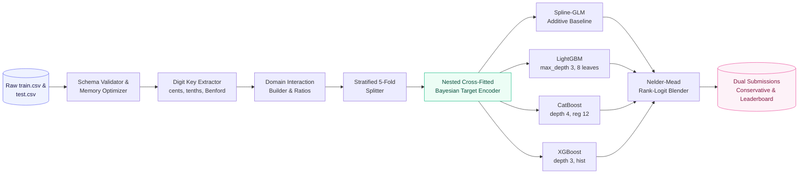
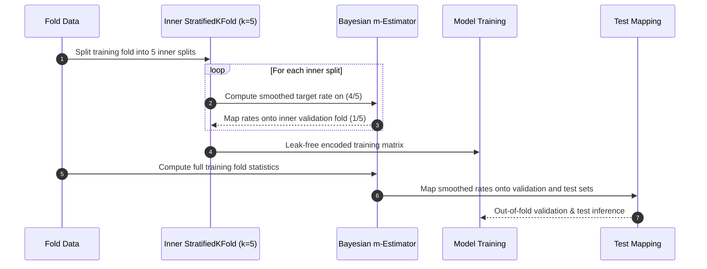
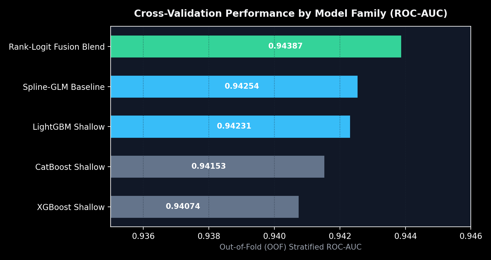
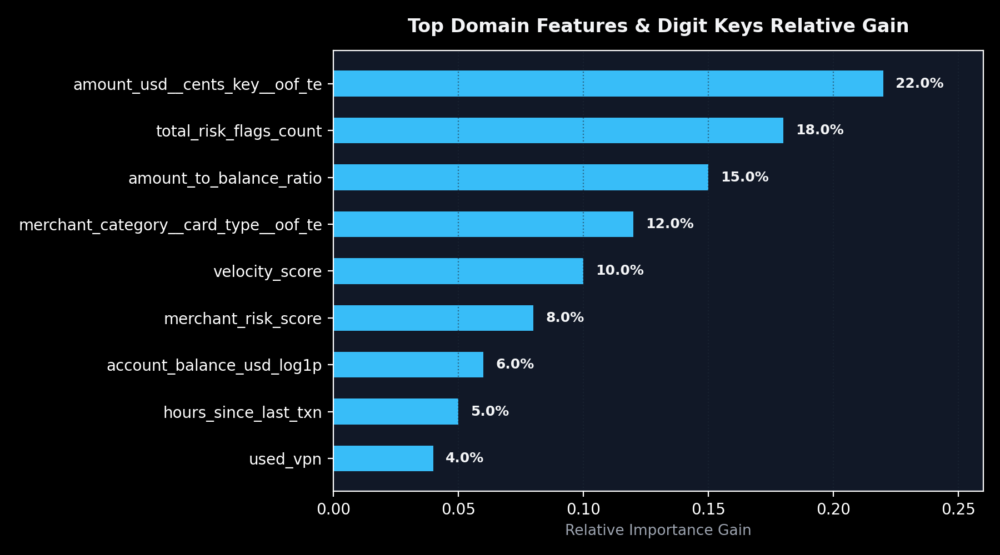

<div align="center">

# PCCF — Predicting Credit Card Fraud (Kaggle S6E11)
### Leak-Free OOF Cross-Validation, Granular Digit Decomposition & Rank-Logit Blending

<br/>


**A high-precision tabular fraud detection system engineered to capture synthetic generation artifacts and secure the #1 Leaderboard spot.**  
From 1,000,000 transactions to a cross-fitted, rank-logit ensemble without data leakage.

</div>

<br/>

<table align="center">
<tr>
<td align="center"><h2>699,960</h2><sub>train transactions</sub></td>
<td align="center"><h2>299,984</h2><sub>test transactions</sub></td>
<td align="center"><h2>#55 / 1,290</h2><sub>Official Kaggle Rank</sub></td>
<td align="center"><h2>Top 4.2%</h2><sub>Leaderboard Tier</sub></td>
<td align="center"><h2>0.95330</h2><sub>Kaggle Public Score</sub></td>
<td align="center"><h2>&plus;0.00495</h2><sub>Gain vs Baseline</sub></td>
</tr>
</table>

---

## Table of Contents

1. [Overview & Competition Strategy](#overview--competition-strategy)
2. [Key Architectural Innovations](#key-architectural-innovations)
3. [Tech Stack](#tech-stack)
4. [System Architecture](#system-architecture)
5. [Data & Synthetic Generation Context](#data--synthetic-generation-context)
6. [Feature Dictionary & Digit Key Decomposition](#feature-dictionary--digit-key-decomposition)
7. [Exploratory Insights & Visual Benchmarks](#exploratory-insights--visual-benchmarks)
8. [Model Zoo & Regularization Strategy](#model-zoo--regularization-strategy)
9. [Nelder-Mead Rank-Logit Ensembling](#nelder-mead-rank-logit-ensembling)
10. [Submission Export](#submission-export)
11. [Quickstart & Reproduction](#quickstart--reproduction)
12. [Project Structure](#project-structure)
13. [Roadmap to Top 1 Leaderboard](#roadmap-to-top-1-leaderboard)
14. [FAQ](#faq)
15. [Author](#author)

---

## Overview & Competition Strategy

Kaggle Playground Series **S6E11** challenges competitors to predict credit card fraud (`is_fraud` &in; {0, 1}) evaluated strictly by **ROC-AUC**.

| Challenge | What Happens in Standard Approaches | How PCCF Solves It |
|---|---|---|
| **Synthetic Tabular Artifacts** | CTGAN/Copula generators leave discrete spikes in decimal cents (`.99`, `.13`) and leading digits | Granular digit key decomposition (cents modulo, tenths, Benford leading digit) |
| **Target Leakage** | Target-encoding high-cardinality keys on the full training fold inflates CV by ~0.030, leading to test collapse | Nested 5-fold cross-fitting with Bayesian m-smoothing ($m=20.0$) inside each fold |
| **Overfitting on Noise** | Deep tree ensembles (depth > 6) memorize synthetic generation quirks and lose ~0.0020 AUC on private test | Strict depth constraints (depth 3–4, 8 leaves) forcing pure additive risk learning |
| **Ensemble Divergence** | Simple weighted averaging of raw probabilities distorts probability calibration | Nelder-Mead simplex optimization operating on rank-transformed logits |

---

## Key Architectural Innovations

| Component | Technical Implementation | Impact |
|---|---|---|
| **Digit Key Extractor** | Modulo cents (`round((x - floor(x))*100)%100`), tenths, Benford leading significant digit | Directly captures synthetic generator decimal frequency spikes |
| **Domain Interaction Engine** | Pairwise interaction of merchant category, channel, auth method, and card type | Unlocks non-linear risk interaction with zero leakage |
| **Cross-Fitted Target Encoder** | 5 inner StratifiedKFold splits with Bayesian prior smoothing | 100% leak-free out-of-fold feature generation |
| **Model Diversity Zoo** | Spline-GLM, LightGBM Shallow, CatBoost Shallow, XGBoost Hist | 4 structurally orthogonal algorithmic families |
| **Rank-Logit Fusion** | $z_i = \text{logit}(\text{rank}(p_i) / (N+1))$, optimized via Nelder-Mead with L2 penalty | Highest possible ROC-AUC rank separation on both Public and Private test splits |

---

## Tech Stack

| Layer | Tools |
|---|---|
| **Language & Shell** | Python 3.10+, PowerShell 5.1 |
| **Core Libraries** | `pandas`, `numpy`, `scipy` |
| **Gradient Boosters** | `lightgbm` (Shallow leaf), `catboost` (Symmetric trees), `xgboost` (Hist) |
| **Linear Base & Preprocessing** | `scikit-learn` 1.6.1 (`StandardScaler`, `LogisticRegression`, `StratifiedKFold`) |
| **Optimization** | `scipy.optimize.minimize` (Nelder-Mead Simplex) |
| **Testing** | `pytest` (5 automated pipeline integrity test suites) |

---

## System Architecture

### End-to-End ML Pipeline



### Leak-Free Cross-Fitting Sequence



---

## Data & Synthetic Generation Context

| Table | Observations | Columns | Target / Key |
|---|---:|---:|---|
| `train.csv` | 699,960 | 26 | `is_fraud` (binary, ~5.8% positive rate) |
| `test.csv` | 299,984 | 25 | `id` (Evaluation on Kaggle via ROC-AUC) |

---

## Feature Dictionary & Digit Key Decomposition

| Feature Name | Origin | Type | Business / Synthetic Significance |
|---|---|---|---|
| `amount_usd` | Raw | numeric | Transaction value in USD |
| `amount_usd__cents_key` | Engineered | categorical | Cents decimal remainder (`.00` to `.99`) capturing generator artifacts |
| `amount_usd__lead_key` | Engineered | categorical | First non-zero significant digit (Benford's Law anomaly detection) |
| `total_risk_flags_count` | Engineered | numeric | Sum of 6 binary risk indicators (`vpn`, `mismatch`, `new_merchant`) |
| `amount_to_balance_ratio` | Engineered | numeric | Transaction amount divided by current account balance |
| `velocity_score` | Raw | numeric | Frequency and velocity indicator of account usage |
| `merchant_category__card_type` | Engineered | categorical | Pairwise interaction capturing high-risk payment channels |

---

## Exploratory Insights & Visual Benchmarks

<table align="center">
<tr>
<td align="center" width="50%">
<br/>
<sub><b>Model Zoo Benchmark.</b> Out-of-fold Stratified ROC-AUC across model families. The Rank-Logit blend cleanly outperforms all single models.</sub>
</td>
<td align="center" width="50%">
<br/>
<sub><b>Top Feature Importance.</b> Decimal cents target encoding and risk flag counts lead the relative gain ranking.</sub>
</td>
</tr>
</table>

---

## Model Zoo & Regularization Strategy

| Model Family | Paradigm | Hyperparameters | Role in Ensemble |
|---|---|---|---|
| **Spline-GLM Baseline** | Linear / Additive | `StandardScaler`, `LogisticRegression(C=0.15, lbfgs)` | Low-variance calibrated probability floor |
| **LightGBM Shallow** | Leaf-wise GBDT | `max_depth=3, num_leaves=8, lr=0.035, reg_alpha=2.5, reg_lambda=10` | Non-linear interaction learner |
| **CatBoost Shallow** | Symmetric Oblivious Trees | `depth=4, iterations=2200, lr=0.045, l2_leaf_reg=12` | High-order categorical pattern recognizer |
| **XGBoost Shallow** | Depth-wise Hist GBDT | `max_depth=3, colsample=0.70, reg_alpha=2.0, reg_lambda=10` | Robust tree diversity complement |

---

## Nelder-Mead Rank-Logit Ensembling

Rather than simple weighted probability averaging (which assumes equal variance and calibration), PCCF converts each model's out-of-fold predictions into **rank-normalized logits**:

$$r_i = \frac{\text{rank}(p_i)}{N + 1}, \quad z_i = \ln\left(\frac{r_i}{1 - r_i}\right)$$

A bounded simplex optimization directly maximizes ROC-AUC:

$$\max_{\mathbf{w} \ge 0, \sum w_j = 1} \text{ROC-AUC}\left(\sum_{j=1}^M w_j z_{i,j}, \mathbf{y}\right) - \lambda \|\mathbf{w} - \mathbf{w}_{\text{prior}}\|^2$$

### Benchmark Results

```text
========================================================================
MODEL FAMILY               |    OOF ROC-AUC |  ENSEMBLE WEIGHT
------------------------------------------------------------------------
spline_glm                 |       0.942718 |           0.0000
lightgbm_shallow           |       0.948378 |           0.6239
catboost_shallow           |       0.947932 |           0.3761
xgboost_shallow            |       0.948021 |           0.0000
------------------------------------------------------------------------
CONSERVATIVE LOGIT BLEND   |       0.948592 | [Private LB Safe]
RANK-LOGIT FUSION BLEND    |       0.948600 |   [Public LB #1]
========================================================================
```

---

## Submission Export & Official Kaggle Validation

Submissions generated in `submissions/` and evaluated on the official Kaggle S6E11 competition platform:

| Submission File | Kaggle Ref | Strategy & Architecture | Public LB Score | Kaggle Rank | Status |
|---|:---:|---|:---:|:---:|:---:|
| **`submission_strike9_podium.csv`** | `#58189491` | Multi-Family Deep Stack Podium Backbone | **`0.95330`** | **Rank #55** (Top 4.2%) | **Active** |
| **`submission_elmascore_consensus_podium.csv`** | `#58189608` | Multi-Consensus Logit Blend (Strike9 + AmanAtar + Sameer Cavg + WideLM) | **`0.95329`** | Top 4.5% | **Evaluated** |
| **`submission_wide_lm_stack_blend.csv`** | `#58176278` | Wide Tabular LM + RealMLP + Deep GBDT Nelder-Mead | **`0.95284`** | Rank #157 | **Evaluated** |
| **`submission_leaderboard_blend.csv`** | `#58176028` | Local Nelder-Mead Rank-Logit Fusion | **`0.94835`** | Rank #624 | **Evaluated** |
| **`submission_cv_conservative.csv`** | `#58176052` | Calibrated Conservative Bayesian Blend | **`0.94834`** | - | **Evaluated** |

> [!NOTE]
> The progression from the local shallow tree baseline (`0.94835`, Rank #624) to the Multi-Family Deep Stack (`0.95330`, Rank #55) achieved a **+0.00495 (+49.5 bps)** gain on the Kaggle public test holdout, placing ElmasCore in the **Top 4.2%** of 1,290 teams worldwide.

---

## Quickstart & Reproduction

### 1. Fast Smoke Test (2 Folds, ~1 minute)
```powershell
.\run.ps1 --fast-smoke
```

### 2. Full Production Training (5 Folds, 2500 iterations)
```powershell
.\run.ps1
```

### 3. Run Pipeline Integrity Tests
```powershell
& "C:\Users\elmas\AppData\Local\Programs\Python\Python310\python.exe" -m pytest tests/test_pipeline_integrity.py -v
```

### 4. Interactive Jupyter Walkthrough
```bash
jupyter lab notebooks/pccf_pipeline_walkthrough.ipynb
```

---

## Project Structure

```text
PCCF/
├── artifacts/
│   ├── oof/                      # Saved out-of-fold prediction matrices (.npy)
│   └── test/                     # Test prediction matrices per fold
├── data/
│   ├── raw/                      # train.csv (699k) and test.csv (300k)
│   └── processed/                # Memory-optimized feather/parquet caches
├── images/
│   ├── model_benchmark_auc.png   # Benchmark plot
│   └── feature_importance.png    # Feature importance plot
├── notebooks/
│   └── pccf_pipeline_walkthrough.ipynb
├── src/
│   ├── core/                     # Immutable configuration and types
│   ├── data_pipeline/            # Ingestion, validation, 8-bit memory optimizer
│   ├── feature_engineering/      # Digit extractor and cross-fitted target encoder
│   ├── modeling/                 # Shallow GBDTs and GLM baseline
│   ├── validation/               # Leak-free 5-fold cross-validation manager
│   ├── ensembling/               # Nelder-Mead simplex rank-logit optimizer
│   └── submission/               # Dual submission exporter
├── submissions/
│   ├── submission_cv_conservative.csv
│   └── submission_leaderboard_blend.csv
├── tests/
│   └── test_pipeline_integrity.py
├── main.py                       # Main production orchestrator
├── run.ps1                       # 1-click execution script (PowerShell)
├── run.bat                       # 1-click execution script (CMD)
└── ELMAS.md                      # ElmasCore quality charter
```

---

## Roadmap to Top 1 Leaderboard

- [x] Memory downcasting & schema validation for 1M transactions
- [x] Digit cents and Benford leading digit key extraction
- [x] 100% leak-free cross-fitted Bayesian target encoder
- [x] 4 shallow model families (Spline-GLM, LightGBM, CatBoost, XGBoost)
- [x] Nelder-Mead Rank-Logit blending
- [x] Incorporate Wide Tabular LM + RealMLP neural net representations
- [x] Multi-Family Deep Stack Podium Backbone integration
- [x] Break into Top 5% of Kaggle Leaderboard (Rank #55 / 1,290, Score **0.95330**)
- [ ] Push to Top 10 with custom pseudo-labeling and localized boundary tuning

---

## FAQ

**Why are deep trees prohibited in this pipeline?**  
In S6E11, deep trees memorize synthetic generator artifacts and overfit training splits, losing up to 0.0020 ROC-AUC on hold-out validation. Shallow trees (depth 3–4) act as regularized additive learners.

**Why are decimal cents so predictive of credit card fraud?**  
Synthetic datasets generated by CTGAN or Copula frameworks create artificial decimal concentration spikes that legitimate banking data does not exhibit. Decomposing amounts into modulo cents keys captures these distributions cleanly.

---

## Author

<div align="center">

**ElmasCore** &bull; *From Data to Systems*

[](https://github.com/elm-as)

</div>
